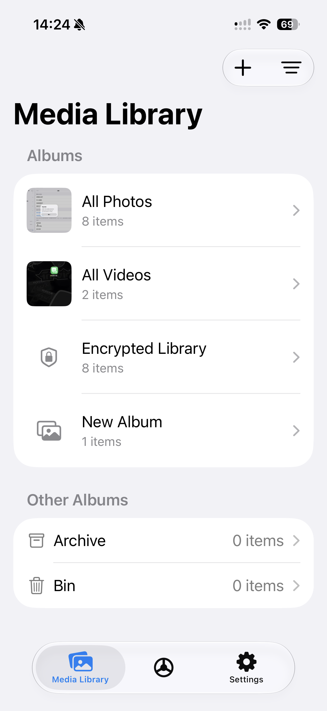
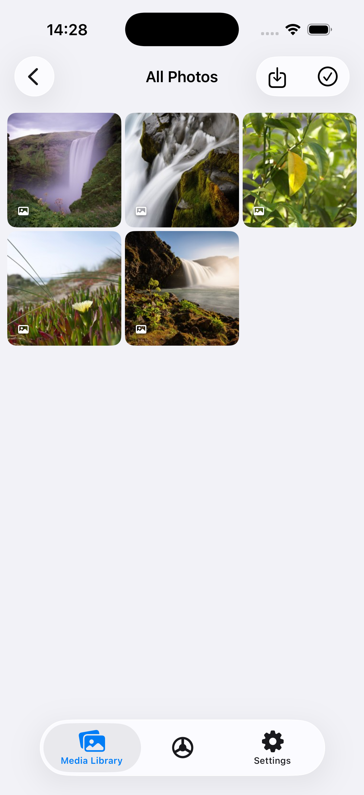
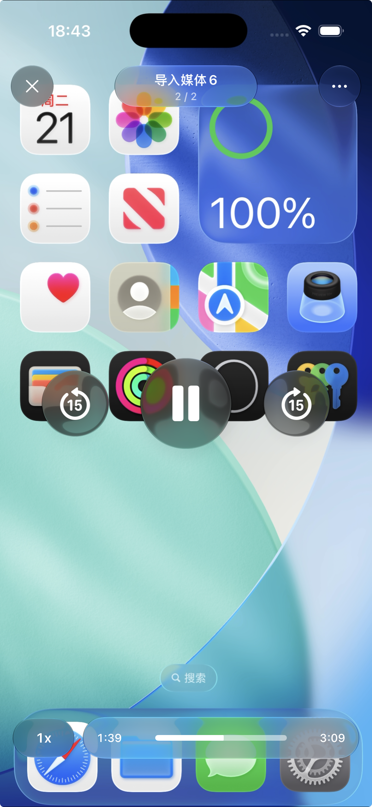
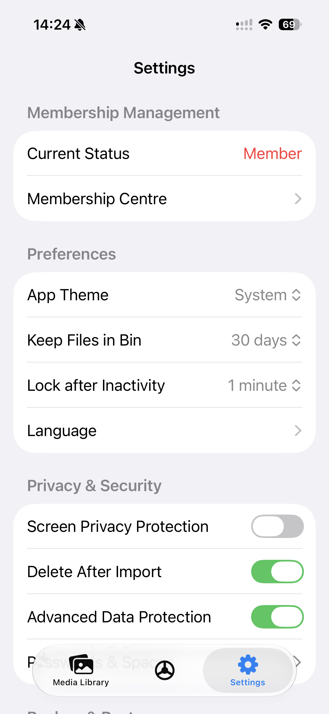
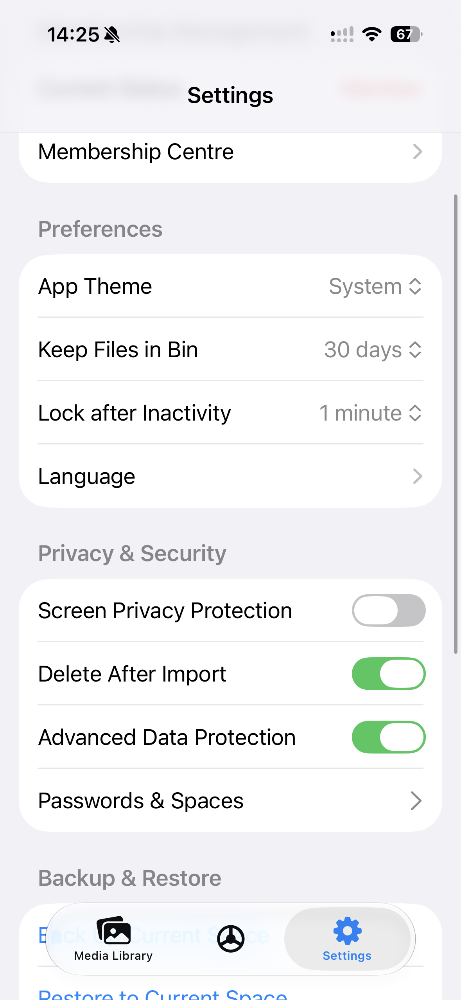
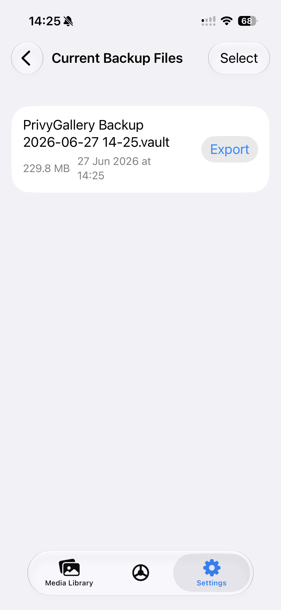

  

<h1 align="center">PrivyGallery</h1>

  <strong>Dual Space Vault</strong> — a local-first, encrypted home for the photos and videos you'd rather keep private.

  <strong>English</strong> ·
  <a href="README.zh-Hans.md">简体中文</a> ·
  <a href="README.zh-Hant.md">繁體中文</a>

  <a href="https://apps.apple.com/us/app/privygallery-dual-space-vault/id6765981187">App Store</a> ·
  <a href="https://privygallery.cinmou.uk">Landing Page</a> ·
  <a href="tools/vault-unpacker/">.vault Unpacker</a> ·
  <a href="docs/vault-format.md">Backup Format</a> ·
  <a href="SECURITY.md">Security</a> ·
  <a href="PRIVACY.md">Privacy</a>

  

---

## Overview

PrivyGallery is a local encrypted photo and video vault for iPhone, iPad and Mac Catalyst. It works without an account or a backend server and does not automatically upload your media.

- Two independent spaces with separate passcodes, optional Face ID / Touch ID, auto-lock and a coercion passcode for emergency erasure.
- Import from Photos, Files or the share extension; organize media into albums, archive and trash.
- Preview photos, Live Photos and videos, with a separate preview path for strongly protected media.
- Create encrypted `.vault` backups and restore them into a space. Large backups use multiple independently restorable parts.

Backups are first stored inside the app. Save or share a copy elsewhere to retain it after uninstalling the app. The standalone [vault-unpacker](tools/vault-unpacker/) can recover files using the backup password without the app.

## Screenshots

| Library | Albums | Media Player |
| :-----: | :----: | :----------: |
|  |  |  |
| **Settings** | **Settings** | **Backup** |
|  |  |  |

## Development and documentation

Open `SecurityFolder.xcodeproj` in Xcode 26 or newer. The app and share extension target iOS 18 or later; the app also supports Mac Catalyst. Configure your own signing team and bundle identifiers for device builds.

- [PRODUCT.md](PRODUCT.md): current product behavior, experience and design decisions.
- [ARCHITECTURE.md](ARCHITECTURE.md): technology, modules, data and technical boundaries.
- [AGENTS.md](AGENTS.md): development rules and build/test commands.
- Topic references: [authentication and privacy](docs/auth-and-privacy.md), [media library and viewer](docs/media-library-and-viewer.md), [backup and restore](docs/backup-and-restore.md), and the [`.vault` format](docs/vault-format.md).

The product and technical documents describe the current working tree. Features available in the App Store depend on the released version. Historical reviews are kept in `docs/archive/` and are read only when relevant.

The app uses CryptoKit, Keychain and LocalAuthentication. No formal third-party security audit has been performed. See [SECURITY.md](SECURITY.md) for the security scope and limitations, and [PRIVACY.md](PRIVACY.md) for data handling.

## Localization

English and British English; Simplified Chinese and Traditional Chinese variants for Taiwan and Hong Kong; German, Spanish, French, Italian, Japanese, Korean and Russian.

## License

[Apache License 2.0](LICENSE).
