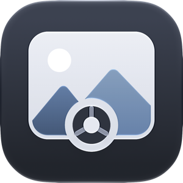
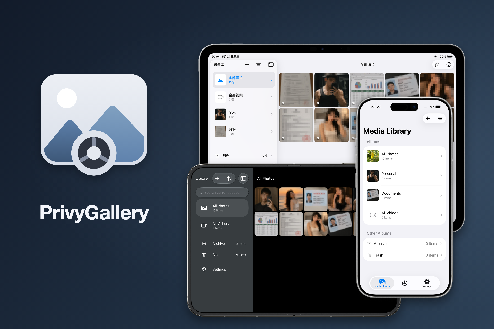

  

<h1 align="center">PrivyGallery</h1>

  <strong>雙空間保險箱</strong> —— 用於私密照片與影片的本機加密空間。

  <a href="README.md">English</a> ·
  <a href="README.zh-Hans.md">简体中文</a> ·
  <strong>繁體中文</strong>

  <a href="https://apps.apple.com/us/app/privygallery-dual-space-vault/id6765981187">App Store</a> ·
  <a href="https://privygallery.cinmou.uk">宣傳頁</a> ·
  <a href="tools/vault-unpacker/">.vault 解包器</a> ·
  <a href="docs/vault-format.md">備份格式</a> ·
  <a href="SECURITY.md">安全</a> ·
  <a href="PRIVACY.md">隱私</a>

  

---

## 概述

PrivyGallery 是適用於 iPhone、iPad 和 Mac Catalyst 的本機加密照片與影片保險箱。不需要帳號或後端伺服器，不自動上傳媒體。

- 兩個獨立空間，分別設定密碼，支援 Face ID / Touch ID、自動鎖定與脅迫密碼緊急清除。
- 從系統照片、檔案或分享延伸功能匯入，用相簿、封存和垃圾桶整理媒體。
- 預覽照片、Live Photo 和影片；強保護媒體使用獨立的預覽路徑。
- 建立加密 `.vault` 備份並還原至空間；大型備份會分成多個可獨立還原的分卷。

備份先儲存在應用程式內，需要另存或分享副本至外部位置，才能在解除安裝後保留。獨立的 [vault-unpacker](tools/vault-unpacker/README.zh-Hant.md) 可以使用備份密碼擷取檔案，不依賴 App。

## 截圖

[商店素材與可編輯來源檔](Materials/AppStore/Creative/README.md)

## 開發與文件

使用 Xcode 26 或更新版本開啟 `SecurityFolder.xcodeproj`。App 與分享延伸功能的部署目標為 iOS 18，App 同時支援 Mac Catalyst。實機建置前設定自己的簽署團隊與 Bundle ID。

- [PRODUCT.md](PRODUCT.md)：目前產品功能、體驗與設計決定。
- [ARCHITECTURE.md](ARCHITECTURE.md)：技術、模組、資料結構與關鍵邊界。
- [AGENTS.md](AGENTS.md)：開發規則、建置與測試指令。
- 專題：[認證與隱私](docs/auth-and-privacy.md)、[媒體庫與播放器](docs/media-library-and-viewer.md)、[備份與還原](docs/backup-and-restore.md)、[`.vault` 格式](docs/vault-format.md)。

產品與技術文件描述目前工作區；App Store 的可用功能以發行版本為準。歷史評審保存在 `docs/archive/`，按需查閱。

應用程式使用 CryptoKit、Keychain 和 LocalAuthentication，目前沒有經過正式的第三方安全稽核。安全範圍與限制見 [SECURITY.md](SECURITY.md)，資料處理方式見 [PRIVACY.md](PRIVACY.md)。

## 本地化

英語與英國英語、簡體中文、台灣和香港繁體中文，以及德語、西班牙語、法語、義大利語、日語、韓語和俄語。

## 授權

[Apache License 2.0](LICENSE)。
